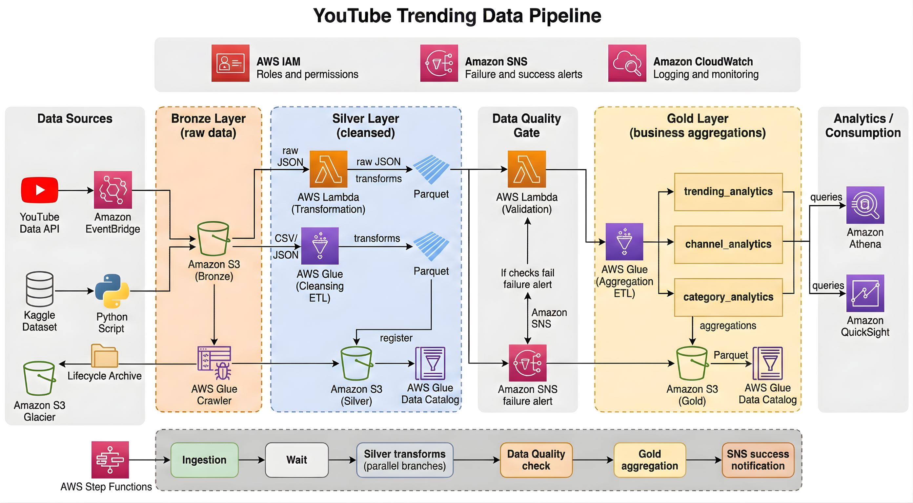

# YouTube Trending Data Pipeline

A serverless AWS data pipeline that ingests YouTube trending-video data and transforms it into analytics-ready datasets using a Bronze, Silver, and Gold lakehouse layout.

> **Deployment status:** This repository contains application code, a Step Functions definition, tests, and a CI workflow. It does not contain infrastructure-as-code or an automated AWS deployment workflow. The architecture diagram includes AWS components that may be configured outside this repository. Review the [deployment readiness](#production-readiness) section before using this as a production system.

## Architecture



The intended flow is:

1. **Ingest:** The YouTube Data API ingestion Lambda fetches popular videos and category reference data for configured regions and writes JSON to the Bronze S3 bucket. Historical Kaggle CSV and category JSON files are also present for bootstrap or development use.
2. **Transform:** The reference-data Lambda normalizes category JSON and writes partitioned Parquet to Silver. The Bronze-to-Silver Glue job cleans statistics, normalizes fields, deduplicates rows, derives engagement metrics, and writes Parquet.
3. **Validate:** The data-quality Lambda queries Silver tables through Athena and checks row counts, required columns, null rates, view ranges, and data freshness.
4. **Aggregate:** If validation passes, the Silver-to-Gold Glue job writes trending, channel, and category analytics.
5. **Notify and consume:** SNS is used for pipeline notifications. Athena and QuickSight are shown as analytics consumers in the diagram; their configuration is external to this repository.

The Step Functions definition runs ingestion, waits briefly, runs reference transformation and statistics ETL in parallel, performs data-quality checks, and only then runs the Gold job. It is a **Standard** state machine definition.

### Repository map

| Path | Purpose |
| --- | --- |
| `lambdas/youtube_api_ingestion/lambda_function.py` | Fetches YouTube API data and writes raw JSON to S3. |
| `lambdas/json_to_parquet/lambda_function.py` | Normalizes category reference data and writes Silver Parquet. |
| `dataquality/data_quality_lambdas.py` | Runs Silver-layer data-quality checks through Athena. |
| `glue/bronze_to_silver_stats.py` | Cleans and deduplicates raw statistics into Silver. |
| `glue/silver_to_gold_analytics.py` | Builds the three Gold analytics tables. |
| `step-function/pipeline_orchestation.json` | Step Functions workflow definition. |
| `tests/` | Unit tests for Lambda/data-quality logic and static Glue-job contract checks. |
| `.github/workflows/ci.yml` | Runs pytest and checks the workflow JSON on pushes and pull requests. |
| `data/` | Historical Kaggle CSV and category JSON files. |
| `docs/architecture.png` | Pipeline architecture diagram. |

## Prerequisites

- Python 3.12 for local tests.
- AWS CLI v2 configured with credentials for the target AWS account and `ap-southeast-2` region.
- Access to the required AWS services: Lambda, Step Functions, S3, Glue, Athena, and SNS. IAM is required to grant service permissions. CloudWatch is used for logs and monitoring.
- A YouTube Data API v3 key with the YouTube Data API enabled.
- Deployed Glue databases, tables/crawlers, jobs, S3 buckets, Lambda functions, an SNS topic, and a Step Functions execution role. These resources are **not provisioned by this repository**.

Do not commit API keys, AWS credentials, or other secrets. Configure the YouTube API key through the Lambda environment using a managed secret solution such as AWS Secrets Manager, with appropriate access controls.

## Configuration

### YouTube ingestion Lambda

| Environment variable | Required | Purpose |
| --- | --- | --- |
| `YOUTUBE_API_KEY` | Yes | YouTube Data API v3 key. |
| `S3_BUCKET_BRONZE` | Yes | Destination Bronze bucket. |
| `YOUTUBE_REGIONS` | No | Comma-separated region codes. Defaults to `US,GB,CA,DE,FR,IN,JP,KR,MX,RU`. |
| `SNS_ALERT_TOPIC_ARN` | No | SNS topic for partial-failure alerts. |

### Reference-data Lambda

| Environment variable | Default | Purpose |
| --- | --- | --- |
| `S3_BUCKET_BRONZE` | `project-yt-bronze-anand` | Source bucket, including Step Functions-triggered reference reads. |
| `S3_BUCKET_SILVER` | `project-yt-silver-anand` | Silver output bucket. |
| `GLUE_DB_SILVER` | `yt_pipeline_silver_dev` | Silver Glue database. |
| `GLUE_TABLE_REFERENCE` | `clean_reference_data` | Silver reference table. |
| `SNS_ALERT_TOPIC_ARN` | Project development topic | Failure alert destination. |

### Data-quality Lambda

| Environment variable | Default | Purpose |
| --- | --- | --- |
| `S3_BUCKET_SILVER` | `project-yt-silver-anand` | Silver bucket configuration. |
| `GLUE_DB_SILVER` | `yt_pipeline_silver_dev` | Default Silver database. |
| `ATHENA_QUERY_RESULTS_S3` | Project development query-results prefix | Athena query results location. |
| `SNS_ALERT_TOPIC_ARN` | Project development topic | Failed-check alert destination. |
| `DQ_MIN_ROW_COUNT` | `10` | Minimum sampled row count. |
| `DQ_MAX_NULL_PERCENT` | `5.0` | Maximum allowed null percentage for critical columns. |

The current code includes development defaults. Set explicit environment values for each deployed environment and replace project-specific defaults before production use.

### Step Functions and Glue

The workflow definition currently contains Lambda ARNs, Glue job names, database names, bucket names, and an SNS topic ARN. Verify each one against the target account before deploying. In particular, check for spelling or environment suffix differences in the Lambda and Glue resource names. Avoid copying a development configuration into production without reviewing every resource reference.

The Glue jobs receive their database, table, and bucket values as job arguments in the state machine definition. The Glue job scripts also require the AWS Glue runtime and are not directly runnable as ordinary local Python scripts.

## Local development and tests

From the repository root:

```bash
python3.12 -m venv .venv
source .venv/bin/activate
python -m pip install --upgrade pip
python -m pip install pytest pandas
python -m pytest -v
```

The tests mock AWS clients for Lambda and data-quality unit tests. Glue tests check syntax and selected job contracts; they do not execute Spark transformations. Run Glue integration tests in an AWS Glue-compatible environment before relying on those transformations in production.

Validate the Step Functions JSON syntax locally:

```bash
python -m json.tool step-function/pipeline_orchestation.json > /dev/null
```

Validate the Amazon States Language definition against AWS:

```bash
aws stepfunctions validate-state-machine-definition \
  --region ap-southeast-2 \
  --type STANDARD \
  --definition file://step-function/pipeline_orchestation.json
```

The AWS validation command requires working AWS CLI credentials. JSON parsing alone checks formatting, not whether the AWS integrations, resource names, or IAM permissions work.

## Run the pipeline

First confirm which AWS account and profile you are using:

```bash
aws sts get-caller-identity
aws configure list
```

Find the deployed state machine ARN:

```bash
aws stepfunctions list-state-machines \
  --region ap-southeast-2 \
  --query 'stateMachines[].{Name:name,Arn:stateMachineArn}' \
  --output table
```

Start an execution using the ARN returned above. Use a unique execution name each time:

```bash
aws stepfunctions start-execution \
  --region ap-southeast-2 \
  --state-machine-arn "STATE_MACHINE_ARN" \
  --name "manual-run-YYYYMMDD-HHMMSS" \
  --input '{}'
```

Starting an execution calls the configured Lambda functions and Glue jobs and can consume YouTube API quota and incur AWS charges. Confirm the state machine points to the intended account and environment before starting it.

Check execution status:

```bash
aws stepfunctions describe-execution \
  --region ap-southeast-2 \
  --execution-arn "EXECUTION_ARN" \
  --query '{Status:status,Started:startDate,Stopped:stopDate,Error:error,Cause:cause}' \
  --output table
```

Inspect the state-by-state execution history:

```bash
aws stepfunctions get-execution-history \
  --region ap-southeast-2 \
  --execution-arn "EXECUTION_ARN" \
  --include-execution-data \
  --output json
```

Lambda and Glue logs are available in CloudWatch Logs when logging is enabled for the deployed resources. The state machine role must allow the required Lambda, Glue, and SNS actions, and each Lambda/Glue execution role must have least-privilege access to its required S3, Glue Catalog, Athena, and SNS resources.

## Continuous integration

The GitHub Actions workflow in `.github/workflows/ci.yml` runs pytest and checks JSON syntax on pushes and pull requests. It does not deploy resources to AWS or start a Step Functions execution. AWS semantic validation and deployment are currently manual.

## Data layout

The ingestion Lambda writes statistics JSON under a Hive-style prefix:

```text
s3://<bronze-bucket>/youtube/raw_statistics/region=<lowercase-region>/date=<YYYY-MM-DD>/hour=<HH>/<ingestion-id>.json
```

It writes reference JSON under:

```text
s3://<bronze-bucket>/youtube/raw_statistics_reference_data/region=<lowercase-region>/date=<YYYY-MM-DD>/<region>_category_id.json
```

Silver outputs are Parquet datasets partitioned by region. The Glue statistics job writes to `youtube/statistics/`; the reference-data Lambda writes to `youtube/reference_data/`. Gold outputs are written to `youtube/trending_analytics/`, `youtube/channel_analytics/`, and `youtube/category_analytics/` in the configured Gold bucket.

The `data/` directory contains historical Kaggle files. For initial or development loading, use an explicit reviewed upload process and ensure the S3 prefixes, Glue Catalog tables, and crawler configuration agree. The included `scripts/aws.copy.sh` is a legacy manual-copy script and should be reviewed and parameterized before use in an automated environment.

## Production readiness

This project is a useful pipeline implementation, but the repository alone is not a complete production deployment. Before production use:

- Provision buckets, roles, policies, Lambda functions, Glue jobs/crawlers, databases, SNS, Step Functions, and logging through reviewed infrastructure-as-code.
- Remove hard-coded account-specific ARNs and development defaults; parameterize account, region, resource names, and environment configuration.
- Store the YouTube API key in a secret manager and rotate it according to your organization’s policy.
- Give each AWS role only the permissions it needs. Enable S3 encryption, block public access, and define retention/lifecycle policies based on business requirements.
- Add alarms and dashboards for failed executions, Lambda errors/throttles, Glue failures, data freshness, and data-quality failures. Set log retention and an operational alert owner.
- Make retries and writes safe for duplicate execution. Review how partial regional failures, empty ingestion results, reruns, and late-arriving data should behave.
- Add integration tests in a Glue-compatible runtime and a deployment smoke test in a non-production AWS environment.
- Deploy through a gated pipeline. Prefer GitHub OIDC with a narrowly scoped IAM role over long-lived AWS access keys. Keep production deployment approval separate from routine pull-request tests.
- Establish data ownership, access controls, cost budgets, API quota monitoring, backup/recovery expectations, and an incident runbook.

## Troubleshooting

| Symptom | First checks |
| --- | --- |
| `AccessDenied` starting or progressing a workflow | Check caller permissions for `states:StartExecution`; check the Step Functions execution role for Lambda, Glue, and SNS access; check the service roles for their own data access. |
| Lambda invocation fails | Check the deployed function name/ARN, environment variables, Lambda logs, API key validity, and YouTube API quota. |
| Reference transform fails | Check the source object exists, its JSON contains category items, and the Lambda has S3 read, S3 write, Glue Catalog, and alert permissions. |
| Glue job fails | Check job names, job arguments, Glue role permissions, catalog tables, input schema, and the Glue job run logs. |
| Data-quality gate fails | Inspect the `dq_result` in execution history, confirm the Athena database/table names and query-results bucket, and review null, row-count, range, and freshness thresholds. |
| Python tests fail locally or in CI | Confirm Python 3.12 is selected and install `pytest` and `pandas`; then run `python -m pytest -v`. |

## License

No license file is currently included. Add a `LICENSE` file before redistributing this project or accepting external contributions.
